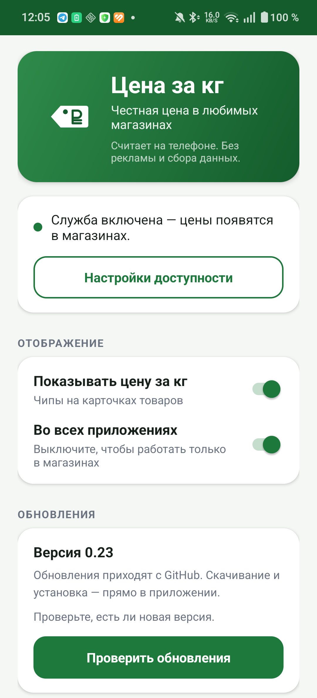
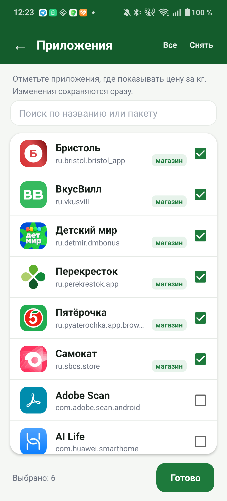

# Цена за кг

<p align="center">
  
  
</p>

Android-приложение, которое показывает **цену за килограмм (или литр) поверх карточек товаров** в приложениях магазинов. Без OCR, без скриншотов, без сбора данных — читает accessibility-дерево экрана и считает арифметику на телефоне.

Главная идея: магазины часто показывают цену за упаковку (`399,99 ₽ за 200 г`), и по ней невозможно сравнить товары. Приложение пересчитывает в `₽/кг` и `₽/л` и рисует маленький чип в углу фотографии.

## Скачать

Последняя версия: **https://github.com/VasiVlad/FairPrice/releases/latest**

1. Скачай APK из раздела Releases.
2. Разреши установку из этого источника.
3. Включи службу: **Настройки → Специальные возможности → «Цена за кг»**.
4. Отключи оптимизацию батареи для приложения.
5. Android 13+: если переключатель серый — в карточке приложения ⋮ → «Разрешить ограниченные настройки».
6. Дальше обновления ставятся изнутри: кнопка «Проверить обновления» на главном экране.

Приложение бесплатное, без рекламы и аналитики. Сеть используется только для проверки и установки обновлений.

## Как это работает

1. `AccessibilityService` получает дерево элементов активного экрана.
2. Парсер вытаскивает цену и вес/объём:
   - `200 г • 399,99 ₽/шт` (Перекрёсток),
   - `13499₽` + `400 г` (Пятёрочка, цены в копейках),
   - `283,00 ₽` + `221 г` (Купер),
   - `price_205₽` в `content-desc` + вес в названии (Ozon Fresh),
   - `119 ₽` справа от старой цены (Самокат).
3. Чип рисуется через `TYPE_ACCESSIBILITY_OVERLAY` в правом верхнем углу фотографии товара.
4. При скролле, касании или смене экрана чипы скрываются; после остановки — пересчитываются.

## Поддерживаемые приложения

Проверено на: Пятёрочка, Перекрёсток, Купер, Самокат, Ozon Fresh, ВкусВилл, Бристоль, Детский мир. Магнит и Дикси — в работе.

По умолчанию приложение работает во всех приложениях, но чипы появляются только там, где нашлись цена и вес. В настройках можно выбрать конкретные приложения, где показывать цену, — так служба не сканирует лишние экраны и меньше расходует батарею.

## Приватность

- Нет аналитики, рекламы и трекинга.
- Нет сервера.
- Единственный сетевой запрос — проверка обновлений на `api.github.com` по нажатию кнопки.
- Всё остальное считается локально.

## Сборка

Нужны JDK 17 и Android SDK (`platforms;android-33`, `build-tools;33.0.2`).

```powershell
powershell -ExecutionPolicy Bypass -File build-manual.ps1
```

Скрипт собирает APK вручную через `aapt2` + `javac` + `d8` + `apksigner`, без Gradle. Готовый файл кладётся в `app-debug.apk`.

## Установка

1. Установить APK.
2. Включить службу: **Настройки → Специальные возможности → «Цена за кг»**.
3. На Android 13+ при установке файлом может понадобиться **«Разрешить ограниченные настройки»** в карточке приложения (⋮).
4. Отключить оптимизацию батареи для приложения, иначе система может выгружать службу.

## Ограничения

- Вес должен быть указан на карточке или в названии. Если его нет — чип не показывается.
- Товары, продающиеся поштучно (`1 шт.`), не пересчитываются.
- Переменный вес (`~1,2 кг`) считается приблизительно.
- Парсер зависит от структуры приложений и может ломаться после их обновлений.

## Разработка

- `main` — стабильные версии для пользователей.
- `dev` — текущая разработка.
- Внутренние заметки, логи и передаточный документ хранятся в приватном репозитории.

## Лицензия

MIT
